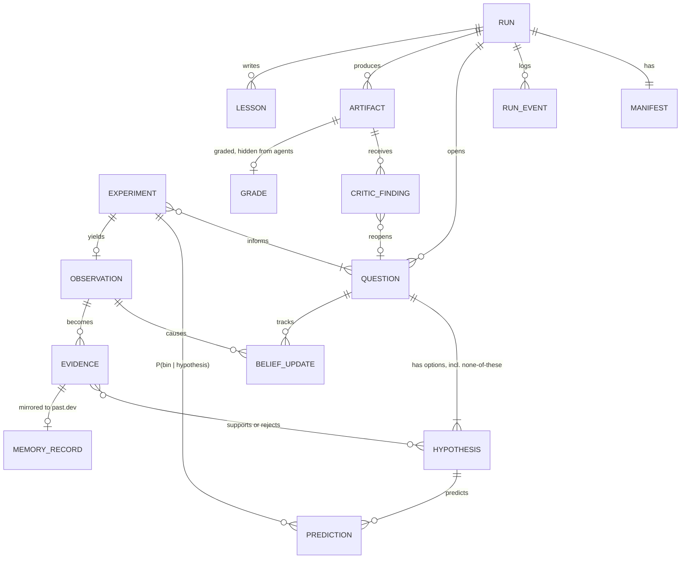

# Crux: Engineering Requirements Document (ERD)

Read this before writing any code. It is self-contained: context, stack, repository layout, the data model with its entity-relationship diagram, the interfaces between modules, conventions, and task briefs with acceptance tests.

Repository: https://github.com/mian-abd/Crux. Deadline: Sunday Nov 15, 2:00 PM PT. Feature freeze: Sunday 11:00 AM.

## 1. What Crux is

Crux is a team of LLM agents that reproduces computational-biology study results. When the agents disagree about an analysis choice (a **question** with competing **hypotheses**), the system does not vote. It proposes cheap **experiments** (diagnostic checks), computes which one is expected to be most informative per unit cost, runs it in a sandbox, and updates its beliefs with Bayes' rule. An end critic checks the final artifacts against their contract. Everything is logged as events so a run can be replayed exactly.

The same engine runs three "labs":

| Lab | Hypotheses are | An experiment is | Graded by |
| --- | --- | --- | --- |
| `boxing` (BoxingGym Location Finding) | Python models with parameters | A point (x, y) to measure | Held-out prediction error |
| `bixbench3` (task 9, differential expression from a count matrix) | Analysis options with outcome bins | A diagnostic script, a docs search, or a run-both-ways comparison | The official BixBench3 artifact grader |
| `bench` (Jetson + camera + screen) | Python models with parameters | A grey level to display and measure | Measurements needed to reach 95% belief |

## 2. Stack

* Python 3.12, `uv`, pydantic v2, `asyncio`, FastAPI + uvicorn, httpx, numpy, pandas, pytest, ruff.
* LLM calls: the `openai` SDK with structured outputs (pydantic schemas). Model names come from config, never hard-coded.
* Sandboxed execution: Modal (Sandboxes for agent code, Functions for heavy compute).
* Search: `exa-py`. Memory: past.dev REST via httpx. Tracing: Langfuse's OpenAI wrapper.
* Front end: Vite + React + TypeScript + Tailwind + Recharts, fed by Server-Sent Events.
* No agent framework. Plain asyncio.

## 3. Repository layout

```
core/         schemas.py  interfaces.py  events.py  config.py  budget.py
              eig.py            # categorical outcome bins
              eig_exec.py       # hypotheses as code (particles)
              orchestrator.py   replay.py   fakes.py
agents/       llm.py  proposer.py  designer.py  predictor.py  referee.py  critic.py  reporter.py  prompts/*.md
labs/         base.py
              boxing/location_finding.py
              bixbench3/task9.py
              bench/lab.py   bench/node.py      # node.py runs on the Jetson, Python 3.6 compatible
diagnostics/  library.py   de_from_counts/      # one small script per diagnostic
execution/    modal_app.py  sandbox.py  image.py  staging.py
memory/       base.py  pastdev.py  local.py
search/       exa.py  policy.py                 # allow and deny rules
api/          server.py
eval/         run_suite.py  baseline_agent.py  grade_bixbench3.py  suites/task9/  results/
web/          the UI
runs/         <run_id>/events.jsonl  manifest.json  artifacts/     # git-ignored except runs/demo/
tests/
```

## 4. Data model

### 4.1 Entity-relationship diagram



### 4.2 Entities (`core/schemas.py`, pydantic v2)

```python
class Question(BaseModel):            # something the agents disagree about (a "fork")
    id: str; text: str
    kind: Literal["categorical", "model"]      # options with outcome bins, or executable models
    impact: float = 1.0                         # 0..1: how much the deliverable changes if we get it wrong
    status: Literal["open", "settled", "robust", "unresolved"] = "open"
    raised_by: str

class Hypothesis(BaseModel):          # one candidate answer (an "option")
    id: str; question_id: str; statement: str; author: str; rationale: str
    answer_key: str | None = None     # options that lead to the same deliverable share a key
    model_code: str | None = None     # kind="model": python source defining predict() and sample_prior()
    is_null: bool = False             # the "none of these" hypothesis, prior 0.15
    prior: float; posterior: float
    status: Literal["active", "rejected", "accepted"] = "active"
    rejected_by: list[str] = []       # evidence ids

class OutcomeBin(BaseModel):
    id: str; description: str
    rule: str                         # evaluated by code on the experiment's JSON result, e.g. "frac_sense > 0.85"

class Experiment(BaseModel):          # a "diagnostic"
    id: str; question_ids: list[str]
    kind: Literal["compute", "search", "multiverse", "measure"]
    goal: str
    language: Literal["python", "r", "bash"] | None = None
    code: str | None = None; query: str | None = None; design: dict | None = None
    bins: list[OutcomeBin] = []
    likelihood: dict[str, dict[str, float]] = {}        # hypothesis_id -> bin_id -> probability
    likelihood_source: Literal["exact", "sampled", "jev", "stated"] = "sampled"
    est_cost_s: float = 30; est_cost_usd: float = 0.0
    eig_bits: float | None = None; score: float | None = None
    spec_hash: str | None = None      # sha256 of code + bins, written BEFORE the run
    status: Literal["proposed", "running", "done", "invalid", "spent"] = "proposed"

class Observation(BaseModel):
    experiment_id: str; valid: bool
    value: float | dict | None = None
    bin_id: str | None = None         # computed by code from `value`, never chosen by a model
    surprise: float = 0.0             # -log p(observation) under the current mixture
    referee_note: str = ""; log_ref: str = ""; seconds: float = 0; cost_usd: float = 0

class BeliefUpdate(BaseModel):
    question_id: str; experiment_id: str
    prior: dict[str, float]; posterior: dict[str, float]
    e_values: dict[str, float] | None = None

class Evidence(BaseModel):
    id: str
    kind: Literal["profile", "observation", "search", "objection", "lesson"]
    claim: str; author_role: str
    source_ref: str | None = None; url: str | None = None
    conditions: dict = {}             # input_hash, code_hash, environment id

class Artifact(BaseModel):
    name: str; path: str; sha256: str
    contract_ok: bool = False; findings: list[str] = []

class CriticFinding(BaseModel):
    id: str; artifact: str; severity: Literal["block", "warn"]
    rule: str; message: str; reopens_question: str | None = None

class Report(BaseModel):
    run_id: str; artifacts: list[Artifact]; methods_md: str
    rejected: list[dict]              # {hypothesis, question, evidence_id, reason}
    unresolved: list[str]; cost_usd: float; seconds: float

class RunEvent(BaseModel):
    run_id: str; seq: int; ts: float; type: str; payload: dict
```

`Grade` lives only in `eval/`. It is never imported by `core/`, `agents/` or `memory/`.

### 4.3 Event types (the UI renders these; `runs/<run_id>/events.jsonl` stores them)

`run.started` · `profile.done` · `question.opened` · `hypothesis.proposed` · `hypothesis.merged` · `experiment.proposed` · `experiment.scored` · `experiment.started` · `experiment.log` · `experiment.finished` · `referee.verdict` · `belief.updated` · `hypothesis.rejected` · `question.settled` · `question.unresolved` · `surprise.raised` · `search.done` · `memory.written` · `memory.recalled` · `artifact.written` · `critic.finding` · `lesson.written` · `run.finished` · `run.error`

## 5. Interfaces (`core/interfaces.py`)

```python
class Lab(Protocol):
    name: str
    def brief(self) -> dict: ...                         # goal, deliverable contract, budget, search policy
    async def profile(self) -> list[Evidence]: ...       # a cheap first look at the data or setup
    def candidate_designs(self) -> list[dict] | None: ...# numeric labs: the design grid. Otherwise None
    async def run(self, exp: Experiment) -> Observation: ...
    async def deliver(self, state: "RunState") -> list[Artifact]: ...
    # grading is NOT on this interface. It lives in eval/ and agents can never call it.

class Executor(Protocol):
    async def open(self, lab_name: str, run_id: str) -> str: ...        # sandbox id; network blocked
    async def exec(self, sandbox_id: str, language: str, code: str, timeout_s: int = 120) -> dict: ...
    async def close(self, sandbox_id: str) -> None: ...

class LLM(Protocol):
    async def structured(self, role: str, schema: type[BaseModel], messages: list[dict], n: int = 1) -> list[BaseModel]: ...

class Predictor(Protocol):            # fills Experiment.likelihood
    async def predict(self, exp: Experiment, hypotheses: list[Hypothesis], context: str) -> dict[str, dict[str, float]]: ...

class Memory(Protocol):
    async def write(self, ev: Evidence, run_id: str, author_role: str) -> None: ...
    async def recall(self, query: str, run_id: str, reader_role: str, k: int = 8) -> list[Evidence]: ...

class Search(Protocol):
    async def find(self, query: str, k: int = 5) -> list[Evidence]: ...   # applies search/policy.py
```

`core/fakes.py` has a canned implementation of every interface so each module can be built and tested alone.

## 6. The two scoring modules

### 6.1 Categorical (`core/eig.py`)

```
likelihood from N = 8 sampled predictions, B bins, noise allowance eps = 0.1:
    P(o | h)  = (1 - eps) * (n_o + 0.5) / (N + 0.5 * B) + eps / B
    P(o | h0) = 1 / B                       # h0 = "none of these", prior 0.15
mixture:   pbar(o) = sum_h pi_h * P(o | h)
EIG(e)   = H[pbar] - sum_h pi_h * H[P(. | h)]                 # bits, Shannon entropy
score(e) = impact(q) * EIG(e) / (1 + 0.2 * est_cost_s / 60)
update:    pi'_h  is proportional to  pi_h * P(o_observed | h)
```

* Options sharing an `answer_key` are summed before computing EIG. If every active option shares one key, the question is closed as `robust`.
* Stop: max posterior >= 0.9 gives `settled`; best EIG < 0.05 bits gives `unresolved`; at most 4 experiments per question.
* Surprise: `pbar(o_observed) < 0.1` or `pi(h0) > 0.4` means regenerate options consistent with every logged outcome, then replay the evidence.
* Optional gate: when an experiment is a real statistical test with p-value p against option h, `e = 0.5 * p ** -0.5`; reject h when the product of its e-values >= 10.

### 6.2 Executable hypotheses (`core/eig_exec.py`)

Each family provides `predict(design, params) -> float` and `sample_prior(rng, n) -> params`. State is a weight per family plus 500 weighted particles per family, and a broad `h0` family.

```
y = predict_k(d, theta_km) + Normal(0, sigma^2)
p(y | k) = mean over m' of Normal(y; predict_k(d, theta_km'), sigma^2)
p(y)     = sum_k pi_k * p(y | k)
EIG_family(d) = E[ log p(y | k) - log p(y) ]
EIG_total(d)  = E[ log Normal(y; predict_k(d, theta_km), sigma^2) - log p(y) ]
```

Update by re-weighting particles with the Gaussian likelihood; resample a family when its effective sample size falls below half; flag a surprise when the observation is more than 4 predictive standard deviations out.

## 7. Conventions

* One branch per issue, named after the Linear issue (for example `du-6-eig-scorer`). Small pull requests into `main`.
* Every module ships with tests. `uv run pytest -q` and `uv run ruff check .` must pass before a pull request.
* Secrets are read from environment variables only. Never commit `.env`. Never print keys.
* Never read from, or write code that reads from, `bixbench3-ground-truth`. Agent sandboxes run with the network blocked.
* Outcome bins are computed by code from a JSON result line (`RESULT: {...}`). A model never decides which bin was observed.
* Every ablation is a config flag in `core/config.py`, never a code fork.
* **Authorship:** every commit is made under the committer's own GitHub identity (`git config user.name` and `user.email` set to your own account), and pushed with your own login. No commit may be authored by a tool or bot account. No co-author or "generated by" trailers in commits or pull requests, and no tools listed as authors or contributors in the README or any document. If a tool produced a change, review it, then commit it yourself.
* Commit messages: imperative, one line, plus an optional body.
* Add every borrowed library, API or repository to the README credits section.

## 8. Task briefs

Each brief is independent. Start from `main`, read sections 4 to 7, build only what the brief says, and open one pull request.

### Brief A: categorical scoring (`core/eig.py`), Linear DU-6

Build `likelihood_from_samples(counts, n_bins, eps=0.1)`, `expected_info_gain(prior, likelihood, answer_keys=None)`, `score(eig, cost_s, impact=1.0, lam=0.2)`, `rank(question, hypotheses, experiments)`, `update(prior, likelihood, observed_bin)`, `is_surprise(prior, likelihood, observed_bin)` and `e_value(p, kappa=0.5)`, following section 6.1. Pure Python and numpy; no network.

Acceptance tests in `tests/test_eig.py`:
1. Two options at 50/50 (plus h0 at 0.15, renormalised) and an experiment where each option predicts a different bin with all 8 samples: EIG is greater than 0.5 bits.
2. An experiment where every option predicts the same bin: EIG is less than 0.01 bits.
3. `update` matches a posterior computed by hand in the test.
4. Options with the same `answer_key`: EIG is about 0 and the helper reports `robust`.
5. An observed bin that every real option gave under 5%: `is_surprise` is true and h0's posterior rises.
6. `e_value(1e-3)` is about 15.8.

### Brief B: executable-hypothesis scoring (`core/eig_exec.py`), Linear DU-40

Implement section 6.2 with numpy only. Provide `ParticleBelief(families, sigma, n_particles=500, seed=0)` with `rank_designs(candidates, goal)`, `update(design, y)`, `family_posterior()`, `predict_mean(design)` and `surprise(design, y)`. Agent-written model code must run in a subprocess with a 2-second timeout and no file or network access.

Acceptance tests in `tests/test_eig_exec.py`:
1. Families `y = a*x` and `y = a*x**2` on designs in [0, 2]: the top-ranked design is at or near 2.
2. Data generated from the quadratic family: its posterior exceeds 0.9 within 6 EIG-chosen observations.
3. Data from `y = sin(5x)`: the surprise flag fires.
4. The same seed gives identical output.

### Brief C: events, API and replay (`core/events.py`, `api/server.py`, `core/replay.py`), Linear DU-18 and DU-45

`EventBus` appends `RunEvent`s to `runs/<run_id>/events.jsonl` and fans them out to async subscribers. FastAPI routes: `POST /runs` (body: lab name and config; starts the orchestrator in the background; returns `run_id`), `GET /runs/{id}/events` (SSE: replays the file, then streams live), `GET /runs/{id}` (current state snapshot), `GET /replays` and `GET /replays/{name}/events?speed=1` (streams a recorded file from `runs/demo/`). `core/replay.py` rebuilds the belief trajectory from an event file alone and compares it with the recorded `belief.updated` events.

Acceptance: `curl -N` on the events route shows events during a fake run (use `core/fakes.py`); a reconnect resumes from the start of the file; `python -m core.replay runs/demo/<file>` exits 0; a test corrupts one event and the replay check fails.

### Brief D: live UI and replay mode (`web/`), Linear DU-19 and DU-20

One screen, no scrolling, readable on a projector (large type, high contrast, dark theme). Panels:
1. Header: lab name, goal, run status, cost and time so far.
2. **Questions**: one card per question with its hypotheses as horizontal posterior bars that animate on `belief.updated`; rejected ones grey out with the reason; `robust` and `unresolved` shown as badges.
3. **Experiment ranking**: candidate experiments with "bits per dollar" bars; the chosen one highlighted; a tag for its kind (compute, search, multiverse, measure).
4. **Console**: streaming `experiment.log` lines and the referee verdict.
5. **Memory and search**: `memory.recalled` and `search.done` entries showing who wrote what and who used it.
6. **Critic**: artifact checklist with pass or fail per contract rule.
7. **Rejected ledger**: every rejected hypothesis with the evidence that rejected it.
8. For the numeric labs: a chart of the model curves, measured points and the next chosen design.

A hidden keyboard toggle switches between live and replay; replay has 1x and 2x speed and pause; replay works with the network off. Build against a recorded fixture `web/fixtures/demo.jsonl` that covers every event type in section 4.3.

Acceptance: the fixture plays end to end with no console errors; unplugging the network during replay changes nothing; all eight panels update from events only (no hard-coded data).

### Brief E: BoxingGym Location Finding port and numeric arms (`labs/boxing/`, `eval/`), Linear DU-41

Port the environment from `kanishkg/boxing-gym` (`src/boxing_gym/envs/location_finding.py`, MIT; credit it): 3 hidden sources in 2-D with theta drawn from N(0, 1); intensity `I(x) = 0.1 + sum_k 1 / (1e-4 + ||theta_k - x||^2)`; Gaussian noise with sigma 0.5; observations rounded to 2 decimals; evaluation is the mean squared error on 10 held-out points drawn from N(0, 1) against the noiseless intensity. Seed numpy explicitly. Implement arms `random`, `grid` and `oracle_eig` (uses `core/eig_exec.py` with the true model structure). Runner: 20 paired seeds, budgets 5, 10 and 20, output a per-seed CSV plus a chart of median log-error against number of experiments with bootstrap 95% intervals.

Acceptance: a unit test checks the intensity formula on a fixed theta; `uv run python -m eval.run_suite boxing --arms random,grid,oracle_eig --seeds 20` writes `eval/results/boxing/summary.csv` and `chart.png`; the oracle arm's median error is below the random arm's at budget 10.

### Brief F: Jetson thin node (`labs/bench/node.py`), Linear DU-44

A single file that runs on Python 3.6 with only the standard library, OpenCV and numpy. Routes: `POST /patch` with `{"level": 0..255}` shows a full-screen grey patch and sleeps 0.4 s; `GET /measure` discards 5 frames, averages the central 80x80 pixels over 8 frames and returns `{"mean", "std", "n"}`; `GET /health` returns the camera settings. A `--camera` flag accepts a device index or a GStreamer pipeline string. A `--fake` flag simulates the camera with `y = 255 * (x / 255) ** 0.9` plus noise, so the laptop side can be built without hardware.

Acceptance: with `--fake`, a script sets 16 levels and reads back a monotonic curve; the file runs under Python 3.6 syntax (no f-string-only features beyond 3.6, no dataclasses, no walrus).

### Brief G: BixBench3 grading wrapper (`eval/grade_bixbench3.py`), Linear DU-14

Wrap the official grader from `EdisonScientific/BixBench3` (pin a commit; Python 3.12). Given `--task 9 --artifacts-dir DIR [--only name1,name2]`, grade each artifact with the official per-artifact function and write `grade.json` containing every artifact's continuous score, the mean, and the fraction of artifacts scoring at least 0.80. The grader must run in its own process and directory; nothing under `core/`, `agents/` or `memory/` may import it.

Acceptance: grading a copy of the published ground-truth artifacts scores about 1.0; grading a DE table with the `padj` column removed scores 0 for that artifact; an import-linter style test fails if `eval.grade_bixbench3` is imported from `core`, `agents` or `memory`.

### Brief H: task 9 fault generator (`eval/suites/task9/make_cases.py`), Linear DU-43

Input: the published task 9 count matrix and a sample sheet (16 samples: T98G Ctrl, C10, F7, G2, D4 and HEK293 Ctrl, D10, E6, two replicates each). Output: 13 case directories (one clean, plus two instances each of: two samples swapped between control and knockout; control and knockout inverted for one cell line; one library duplicated under a second name; one library down-sampled 50x; cell-line column wrong for two samples; gene ID versions inconsistent between matrix and annotation). Fixed seed. Each case directory holds only what an agent may see. A separate `truth.json`, written outside the case directories, records the fault and the affected samples.

Acceptance: running twice gives byte-identical cases; no case directory contains the word "fault", the truth file, or the original sample sheet; a test confirms each fault changed exactly the intended samples.
