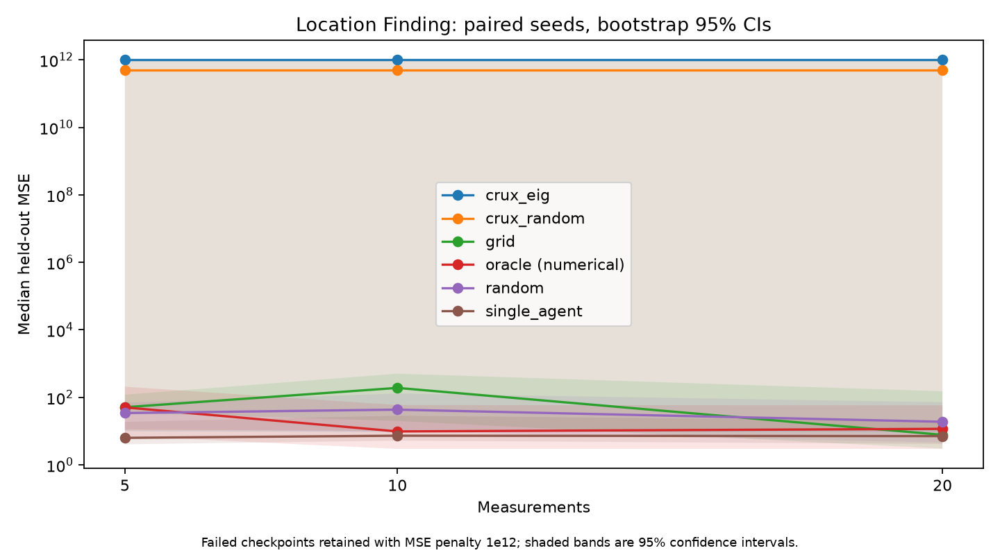
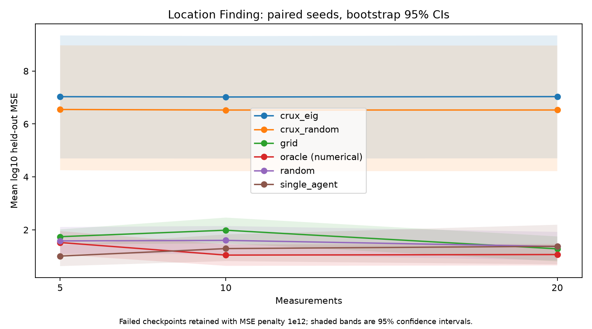

# DU-41: Location Finding study

This run does **not establish an EIG advantage**. The paired EIG-minus-random
log10-error confidence intervals include zero at all three checkpoints.
Generated-model failures dominate the Crux aggregates; one additional EIG
episode failed because Windows denied an atomic manifest replacement.
Failures remain in every primary aggregate with the preregistered MSE penalty
of 1e12. The large Crux medians reflect failed predictions, not measured
physical signal errors of that size. No successful-only comparison replaces
these primary results.

## Protocol and evidence

The main study attempted all six arms on 20 paired seeds (100–119), with a
single 20-measurement trajectory and held-out evaluations at 5/10/20. All 120
episodes and 360 checkpoint rows are retained. Every seed has matching hidden
source and held-out-point hashes across arms, and every saved measurement
replays exactly from the seeded simulator. Both Crux arms received identical
generated source hypotheses per seed. Model calls used gpt-4.1-mini.

- [Frozen protocol](main-20261114/protocol.json), recording execution source
  commit `5d543cceb14fe6ba91546334d4ebf7b63f326681`.
- [Per-seed scores](main-20261114/per_seed.csv),
  [summary and bootstrap intervals](main-20261114/summary.json),
  [paired comparisons](main-20261114/paired_comparisons.json),
  [cost/time/target table](main-20261114/costs.csv), and
  [audit](main-20261114/audit.json).
- [Implementation and full protocol](../../../docs/BOXING_STUDY.md).
- Episode folders contain histories and diagnostics; Crux folders also contain
  event streams and manifests. `proposals-SEED.json` preserves raw generated
  code and validation failures. Representative random/EIG Crux trajectories
  independently replay all 20 recorded belief updates.

Gavin approved a **labeled numerical known-structure reference** in place of
the original exact-oracle wording. It uses the true functional structure and
prior, never the actual source coordinates. EIG and posterior inference are
finite-particle approximations, with 256 particles and 16 simulated outcomes.
The pilot and saved parameter-spread diagnostics expose particle collapse.
This line is not an exact oracle or a proven performance upper bound.
The Gaussian approximation to rounded observations is another limitation.

## Results at 20 measurements

Intervals are seed-bootstrap 95% CIs (2,000 resamples). Log error means log10 MSE.

| Arm | Median MSE [CI] | Mean log error [CI] | Failed episodes / 20 | Reached MSE ≤ 1 by checkpoint 20 |
|---|---:|---:|---:|---:|
| crux_eig | 1e+12 [9.301, 1e+12] | 7.034 [4.703, 9.345] | 11 | 0 |
| crux_random | 5e+11 [10.39, 1e+12] | 6.529 [4.218, 8.964] | 10 | 0 |
| grid | 7.768 [3.036, 151.1] | 1.283 [0.809, 1.753] | 0 | 1 |
| oracle (numerical) | 11.7 [2.978, 58.07] | 1.068 [0.6564, 1.467] | 0 | 3 |
| random | 18.94 [4.582, 71.79] | 1.372 [0.845, 1.924] | 0 | 1 |
| single_agent | 7.127 [4.172, 20.1] | 1.38 [0.6979, 2.194] | 0 | 3 |

Target times in the cost table are checkpoint-resolved and right-censored when
not reached; blank values are not successes. This does not estimate the exact
first crossing between checkpoints.

| Measurements | Paired mean log10 MSE difference: EIG minus random | 95% CI |
|---:|---:|---:|
| 5 | 0.4841 | [-0.0703, 1.5407] |
| 10 | 0.4926 | [-0.0534, 1.5517] |
| 20 | 0.5056 | [-0.0378, 1.5562] |

Negative differences favor EIG. These intervals include zero, so neither EIG
superiority nor random superiority is established by this run.

## Costs and failures

| Arm | Direct calls | Input tokens | Output tokens | Direct USD | Shared proposal USD |
|---|---:|---:|---:|---:|---:|
| random | 0 | 0 | 0 | 0.000000 | 0.000000 |
| grid | 0 | 0 | 0 | 0.000000 | 0.000000 |
| oracle | 0 | 0 | 0 | 0.000000 | 0.000000 |
| single_agent | 460 | 137261 | 8245 | 0.068096 | 0.000000 |
| crux_random | 0 | 0 | 0 | 0.000000 | 0.028405 |
| crux_eig | 0 | 0 | 0 | 0.000000 | 0.028405 |

Shared hypotheses are generated once per seed and reused by both Crux arms.
That cost is displayed with both arms but counted **once** in the actual study
total: **$0.0965012**, 480 calls,
141,601 input tokens and 24,913 output tokens.
These are wrapper-accounted list-price estimates, not a provider invoice.
Per-episode calls, tokens, shared costs, durations, failure counts and censored
target checkpoints are available in the cost CSV. No spend cap was reached.

There were 21 failed episodes (63 failed checkpoints): 14 episodes with no
prediction after generated-code validation failed, 6 episodes rejected by the
production particle engine for unusable prior or prediction shapes, and 1 Windows manifest
replacement failure (seed 102, EIG). The latter remains in the primary result.
A bounded retry for transient Windows sharing/access errors was added after
the run; it does not rewrite the archived failed episode.

## Scope and reproducibility

The two Crux arms differ only in design selection, with shared generated models,
inference settings, candidate grid and case seed. Their scalar forecast task
uses the real numeric orchestrator, deterministic reporting and no artifact
critic. The single agent reasons/predicts in text; its comparison with Crux is
a system comparison with different representations. The numerical reference
has additional structural knowledge. This is simulator evidence, not evidence
of scientific discovery. Model generation itself is not seed-reproducible;
raw generated source is retained for replay.

`pilot-20261114/` contains the separate 20-seed, three-arm pilot (60 episodes,
180 valid checkpoint scores, zero model calls). It was delivered after the
historical Saturday 6 PM milestone; that deadline is not claimed as met.
`agent-preflight-*` folders preserve development checks, including failures;
they are not pooled into the fresh-seed main study or its cost total.
The second environment is an optional stretch item and was not implemented.

The next reliability work suggested by these results is validating/repairing
generated model shapes before larger studies and improving posterior sampling
before treating the numerical reference as a strong comparator. Those changes
would require a newly frozen study rather than rewriting these results.
