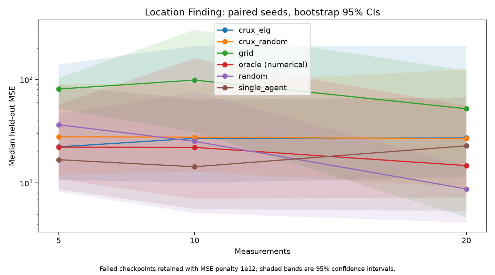
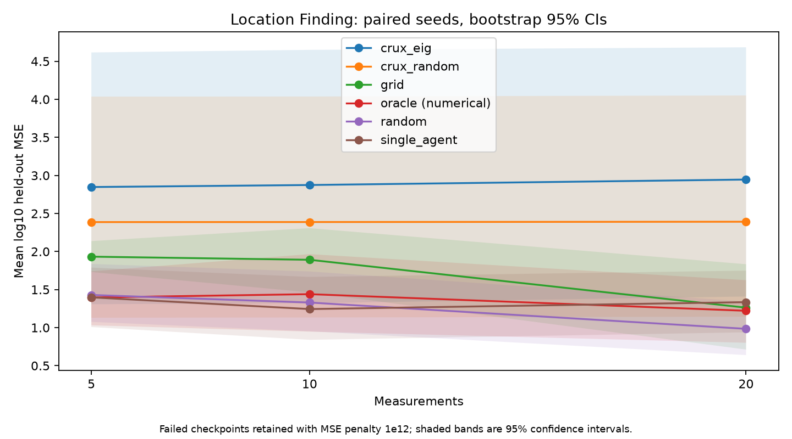

# DU-41 repaired model and EIG study — November 15, 2026

**This run does not establish an EIG advantage; the paired 95% confidence interval includes zero.**

The new study retains all 120 episodes and 360 checkpoints on fresh paired seeds 4000–4019.
Failed checkpoints remain in every primary aggregate with MSE penalty 1e12. Lower error is better.

## Changes

- Shared strict shape, finite-output, determinism and reproducibility checks for local and Modal runners; sandbox prediction inputs are read-only.
- At most two AI repair attempts per hypothesis, retaining original and repaired code, errors and usage. Both Crux arms share the same final models per seed.
- Four resample-and-move sweeps using the full observation history, replacing arbitrary jitter in this study. Generated models use prior-independence MH; the known-structure reference also uses local moves with its Normal prior.
- 512 particles and 64 EIG simulations, frozen before the main run. Other labs retain legacy settings unless moves are enabled explicitly.
- Modal source packaging excludes result/evaluator files and disables automatic source mounting.

[Frozen repair protocol](../../../docs/DU-41-REPAIR-PROTOCOL.md) and [execution protocol/revision](repair-main-20261115/protocol.json).

## Primary results

| Arm | Median MSE at 20 [95% CI] | Mean log10 MSE [95% CI] | Failed episodes / 20 | Reached MSE ≤ 1 |
|---|---:|---:|---:|---:|
| crux_eig | 27.18 [11.38, 210.5] | 2.946 [1.409, 4.684] | 3 | 2 |
| crux_random | 26.75 [9.102, 125] | 2.392 [1.143, 4.051] | 2 | 3 |
| grid | 52.07 [4.623, 121.8] | 1.262 [0.712, 1.833] | 0 | 5 |
| oracle | 14.69 [7.232, 55.6] | 1.222 [0.8013, 1.624] | 0 | 3 |
| random | 8.737 [4.143, 14.69] | 0.9843 [0.6393, 1.343] | 0 | 4 |
| single_agent | 22.8 [5.342, 66.8] | 1.335 [0.9386, 1.749] | 0 | 2 |

CIs use 2,000 whole-seed bootstrap resamples. Target times are checkpoint-resolved and censored when not reached.

| Measurements | Paired mean log10 MSE: EIG minus random | 95% CI |
|---:|---:|---:|
| 5 | 0.4607 | [-0.1261, 1.5264] |
| 10 | 0.4865 | [-0.1021, 1.5509] |
| 20 | 0.5542 | [-0.0298, 1.6071] |

Negative favors EIG. These results compare the two current Crux arms, not EIG in general.

## Reliability, cost and limitations

4/20 proposal sets were accepted after repair; 2/20 remained unusable. 11 repaired versions were validated. All terminal failures remain in the dataset.

Primary wrapper-accounted spend: **$0.1055536**, 491 calls, 149,368 input and 28,629 output tokens. Shared proposals/repairs count once in actual spend and are shown with each Crux arm. These are configured list-price estimates, not an invoice; unreturned billed usage cannot be fully reconciled. Development and Modal checks are separate.

The additional EIG failure was a Windows NumPy DLL import failure at seed 4018, not an array-shape failure. It is retained with the declared penalty and materially affects the paired contrast. A narrowly scoped, two-retry startup guard was added and tested after the run; it does not change this archived outcome. There were no production array-contract failures among the accepted model sets.

The reference knows the true formula and prior, never hidden coordinates. It remains numerical, with a Gaussian approximation to rounded observations. Moves are posterior-preserving kernels, but four sweeps do not guarantee mixing or posterior accuracy. Low acceptance and particle duplication persist: pooled move acceptance is about 6.5% for Crux random and 4.9% for Crux EIG; median post-move distinct particles are 51 and 11 out of 512, respectively. This remaining loss of diversity limits claims that inference is fully fixed. See per-episode diagnostics and [aggregated move diagnostics](repair-main-20261115/findings.json).

[Ranking sensitivity](repair-numerics-20261115.json) on development seeds compared 512/64 with 2048/256 particles/simulations before data and after five fixed measurements. Rank correlations were about 0.92–0.98; the top design agreed in 3/6 comparisons. This does not establish convergence of the selected design.

The scalar Crux study disables artifact criticism. The single-agent comparison uses a different inference representation. Several fixes and numerical settings changed together, and cases differ from the original study, so before/after differences do not identify the effect of one fix. This is simulator evidence, not scientific discovery.

## Evidence

- [Per-seed scores](repair-main-20261115/per_seed.csv), [summary](repair-main-20261115/summary.json), [paired comparisons](repair-main-20261115/paired_comparisons.json), [cost table](repair-main-20261115/costs.csv), [audit](repair-main-20261115/audit.json).
- Proposal JSON files retain validation and repair attempts. Episode directories retain histories, diagnostics, and Crux events/manifests. The audit checks pairing, every saved observation, shared hypothesis sources, cost reconciliation and representative event replays.
- **367 repository tests passed; Ruff passed.** Tests cover malformed arrays, repair exhaustion, analytic Gaussian posterior moments with both move types, EIG against analytic and independent quadrature references, noise sensitivity, simple-model resolution checks, reproducibility, scoring-query purity, source exclusions and narrowly bounded NumPy startup retries.
- [Two-job Modal integration check](repair-modal-03-20261115/summary.csv): single-agent and Crux both executed, persisted evidence and graded. Two earlier packaging attempts failed before job dispatch; their manifests remain archived.
- [Original study report](ORIGINAL_STUDY.md), [original results](main-20261114/summary.json), [archived original issue](../../../docs/DU-41-original-linear.md). Original failures and the missed historical deadline are not rewritten. The optional second environment remains deferred.
